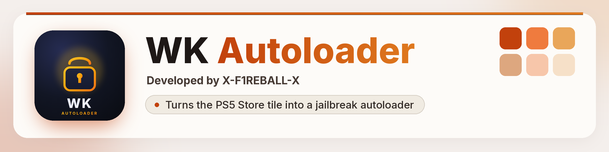
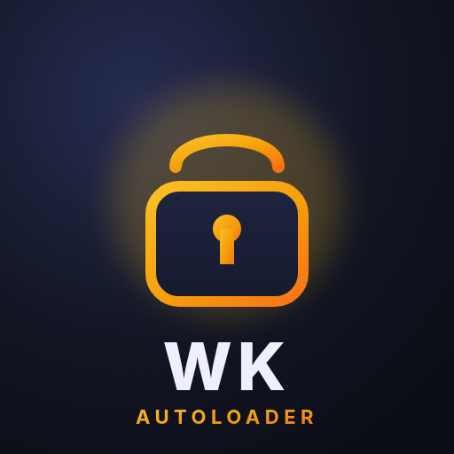
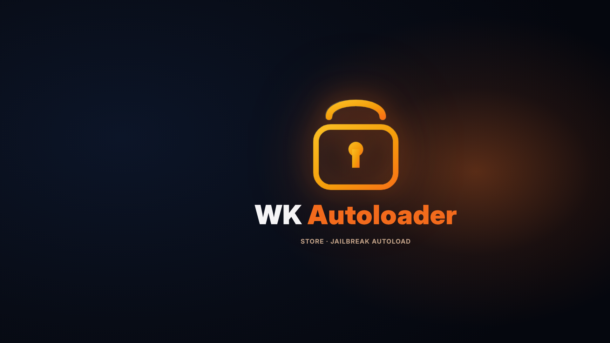

Turns the PS5 Store tile into WK Autoloader: open the tile, start the jailbreak, and Elf Launcher opens when it finishes.

## Quick start

1. Send [`WK_Autoloader_Store_V1.1.5.elf`](https://github.com/X-F1REBALL-X/wk-autoloader/releases/download/v1.1.5/WK_Autoloader_Store_V1.1.5.elf) to elfldr on port `9021`.
2. Wait for the install to finish, then reboot.
3. Open the **Store** tile and press **Start Jailbreak**.

## Contents

- [Features](#features)
- [Gallery](#gallery)
- [Requirements](#requirements)
- [Installation](#installation)
- [Restore the PlayStation Store tile](#restore-the-playstation-store-tile)
- [What's new in 1.1.5](#whats-new-in-114)
- [Building from source](#building-from-source)
- [License](#license)
- [Credits](#credits)

## Features

- Replaces the Store tile on the home screen with WK Autoloader.
- Runs the Relapse jailbreak from the tile, then opens Elf Launcher by itself.
- Works offline after install. Send the ELF again only to reinstall or update.
- Each install clears the old WebKit cache first, so the cache is always filled from scratch.
- A separate Restore ELF puts the original PlayStation Store tile back.

## Gallery

Store tile icon and background:

<p> </p>

## Requirements

- PS5 firmware 7.00–13.60 (Relapse).
- elfldr listening on port `9021`.
- A way to send an ELF to elfldr, for example after an earlier jailbreak.

## Installation

1. Send [`WK_Autoloader_Store_V1.1.5.elf`](https://github.com/X-F1REBALL-X/wk-autoloader/releases/download/v1.1.5/WK_Autoloader_Store_V1.1.5.elf) to elfldr on port `9021`.
2. Wait until the install finishes, then reboot the console.
3. Open the **Store** tile on the home screen.
4. Press **Start Jailbreak**. After Relapse completes, Elf Launcher opens automatically.

## Restore the PlayStation Store tile

Send [`WK_Autoloader_Store_Restore_V1.1.5.elf`](https://github.com/X-F1REBALL-X/wk-autoloader/releases/download/v1.1.5/WK_Autoloader_Store_Restore_V1.1.5.elf) to elfldr on port `9021`, then reboot. This also clears the WK cache.

## What's new in 1.1.5

- Clears Store AppCache only when the manifest version changes (per user); backs up to /data/wkal/appcache_backup/ first.
- Store Restore backs up then clears the Store AppCache origin for every user profile.
- Install waits until Offline cache complete (does not finish early on a stall).
- Removes old tile images before installing new ones.

All versions are on the [releases page](https://github.com/X-F1REBALL-X/wk-autoloader/releases).

## Building from source

Needs the [PS5 payload SDK](https://github.com/ps5-payload-dev/sdk) with libmicrohttpd.

```bash
make store SDK=/path/to/ps5-payload-sdk BUILD_TYPE=stable
make restore SDK=/path/to/ps5-payload-sdk
```

Outputs `WK_Autoloader_Store_V1.1.5.elf` and `WK_Autoloader_Store_Restore_V1.1.5.elf`.

## License

[GNU GPL v3](LICENSE).

## Credits

- Relapse (PS5 WebKit / kernel chain, vendored under `frontend/autoloader/relapse/`)
- [ps5-elfldr](https://github.com/itsPLK/ps5-elfldr) by itsPLK
- [elf-launcher](https://github.com/X-F1REBALL-X/elf-launcher)
- SQLite (Store tile database remap)

Developed by X-F1REBALL-X.
